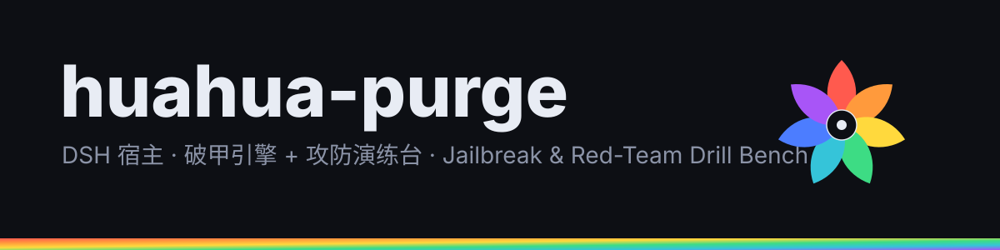

<div align="center">


# huahua-purge

**DSH host plugin: jailbreak engine + red-team drill bench in one bundle**

[](LICENSE)

</div>

---

`huahua-purge` is a bundle plugin for **DeepSeek Harness (DSH)** that does two things:

| Capability | What it does |
|---|---|
| **purge** | Strips the identity and persona prefix injected by the host, so any model follows your prompt. Per-model prompt sets. |
| **redteam** | A persistable drill bench: 23 attack skill files, a SQLite asset store, five-role orchestration, and an HTTP bridge. |

## Quick start

```bash
dsh plugin --profile desktop add "github:azure5100/huahua-purge"
# restart the host afterwards — bundle plugins need a full restart
```

## Requirements

```
DSH  >= 0.2.1-rc.2
Node >= 20
peer: @deepseek-ai/cordis ^4.0.1
```

## Highlights

- Identity purge: `includeHarnessIdentity: false`, empty `personaPrefix`
- Per-model prompts, auto-retry on rejected requests (3x), optional auto-continue
- Hook deny-bypass so the plugin Stop/steer hooks cannot be routed around
- Five red-team roles, concurrency capped at 3, asset store under `$DSH_HOME/huahua-purge`
- Auto-disables the legacy `dsh-redteam-mode` / `-store` / `-ui` rows to avoid double registration

## Documentation

- [中文说明（推荐）](README.zh-CN.md)
- [使用手册](docs/USAGE.zh-CN.md)
- [来源与衍生声明](NOTICE.md)

## Scope

Built for authorized environments: your own assets, authorized pentests, CTFs, internal drills. The red-team skills contain executable payload examples.

## License

[MIT](LICENSE) — derivative of [dsh-purge](https://github.com/YuJunZhiXue/dsh-purge) 1.1.71 (MIT, (c) 2026 小杨).
