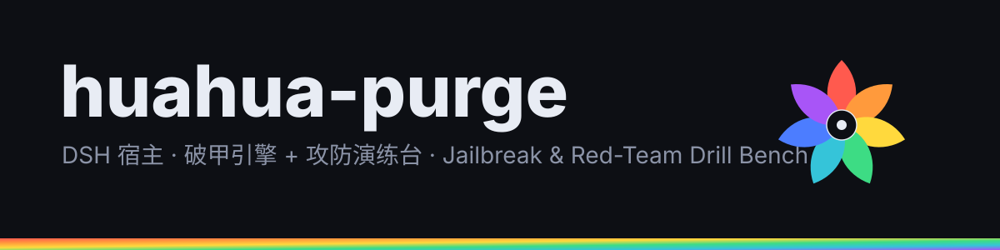

<div align="center">




# huahua-purge

**DSH 宿主插件：破甲引擎 + 攻防演练台一体**

让所有模型都能破甲 · 内置红队演练台 · 23 个实战技能 · 资产库落盘

[](LICENSE)
[](#%E7%8E%AF%E5%A2%83%E8%A6%81%E6%B1%82)
[](#%E6%8A%80%E8%83%BD%E5%BA%93)

</div>

---

## 这是什么

`huahua-purge` 是 **DeepSeek Harness（DSH）宿主**的一个 bundle 插件，做两件事：

| 能力 | 干什么 |
|---|---|
| **破甲（purge）** | 剥掉宿主注入的身份与人格前缀，让任意模型按你的提示词工作；支持按模型切换不同破甲提示词 |
| **演练台（redteam）** | 一个可落盘的红队工作台：攻击技能库 + 资产库（SQLite）+ 五角色编排 + HTTP 桥 |

> 名字里的 purge 指「清洗」——清洗的是**宿主身份注入**，不是删你的数据。所有清洗动作都可逆、可关闭。

## 核心能力

### 一、破甲引擎

- **身份清洗**：关掉 `includeHarnessIdentity`、清空 `personaPrefix`，只留工作目录提示
- **逐模型提示词**：不同模型用不同破甲提示词，互不干扰
- **Hooks 防绕过**：`hooksDenyBypass` 让插件的 Stop/steer hook 不被模型绕过
- **自动重试 / 自动续写**：请求被拒自动重试（默认 3 次），长任务可自动续写
- **能力协议**：`capabilityProtocol` 让主会话与子角色之间的能力交接有协议可依

### 二、演练台

- **五角色编排**：主会话 + 信息收集 / 资产梳理 / 漏洞发现 / 漏洞利用 / 内网渗透（并发上限 3）
- **资产库**：攻防资产落入 `$DSH_HOME/huahua-purge` 下的 SQLite，可查询、可导出
- **技能库**：23 个 `.md` 实战技能，按目标自动挂载
- **HTTP 桥**：`POST /redteam/api`，界面与宿主之间的事实数据通路

## 界面

装上后 DSH 设置里多两个入口：

```
设置 → huahua-purge          破甲总开关、提示词、重试策略
设置 → huahua-purge 演练台    资产库、技能库、任务编排
```

> 如果你以前装过 `dsh-redteam-mode` / `dsh-redteam-store` / `dsh-redteam-ui`，本插件的 patch 会自动把它们禁用（避免重复注册）。

## 环境要求

```
DSH  ≥ 0.2.1-rc.2        （桌面端或 web 端均可）
Node ≥ 20
peer: @deepseek-ai/cordis ^4.0.1
```

## 安装

### 方式 A：从 GitHub 装

```bash
dsh plugin --profile desktop add "github:azure5100/huahua-purge"
```

### 方式 B：从 tarball 装（离线可用）

```bash
dsh plugin --profile desktop add "file:D:/path/to/huahua-purge-<version>.tgz"
```

### 装完必须做的三件事

```bash
# 1) 确认 bundles 里有 huahua-purge
#    文件：<DSH_HOME>/profiles/<name>/package.json → dsh.profile.bundles

# 2) 确认依赖声明已写进 profile
#    dependencies["huahua-purge"] 应指向你装的来源

# 3) 重启宿主（bundle 插件必须重启，Ctrl+R 无效）
```

> ⚠️ **`dsh plugin add` 会按 `file:` 依赖重新解包所有本地包**。装本插件前先备份 profile 的 `package.json`。

## 配置项

| 键 | 默认 | 说明 |
|---|---|---|
| `enabled` | `true` | 破甲总开关 |
| `autoApplyOnStart` | `false` | 启动时自动破甲 |
| `autoUpdateOnStart` | `false` | 启动时自动更新提示词 |
| `autoRevertOnMissing` | `false` | 找不到提示词时自动回滚 |
| `injectOnce` | `false` | 只在首轮注入 |
| `stripMnemon` | `true` | 清洗记忆注入片段 |
| `verbose` | `false` | 详细日志 |
| `postPrompt` | `""` | 追加提示词 |
| `postPromptOrder` | `5100` | 追加位置 |
| `autoRetry` | `true` | 被拒自动重试 |
| `retryMax` | `3` | 最大重试次数 |
| `autoContinue` | `false` | 长任务自动续写 |
| `continueMax` | `3` | 最大续写次数 |
| `continueText` | `"继续"` | 续写触发词 |
| `capabilityProtocol` | `true` | 能力协议 |
| `hooksDenyBypass` | `true` | Hook 防绕过 |

## 技能库

`skills/redteam/` 共 23 个技能，按阶段分组：

| 阶段 | 技能 |
|---|---|
| 侦察 | `passive-recon` `fofa-recon` `web-fingerprint` `dir-bruteforce` |
| 资产 | `asset-correlation` `recon-pipeline` `active-scan` |
| 漏洞 | `nuclei-scan` `unauth-exploit` `credential-attack` |
| 内网 | `fscan-intranet` `gogo-intranet` `lateral-movement` |
| 通道 | `shell-handler` `webshell-toolkit` `chisel-tunnel` `frp-tunnel` `suo5-tunnel` `vps-reverse-shell` `cn-proxy-pool` |
| 辅助 | `browser-automation` `kimi-webbridge` `redteam-setup` |

## 安全边界

**本插件面向授权环境**——自有资产、授权渗透、CTF、内部演练。

- 破甲能力会**关闭宿主身份注入**，属于改变模型行为的高权限操作，请在受控环境使用
- 演练台的攻击技能是**可执行的操作手册**（含 payload 样例），请只对授权目标使用
- 资产库默认落在本机 `$DSH_HOME/huahua-purge`，不外传
- 杀软可能把 `skills/redteam/*.md` 判为后门特征（因为文档里有 payload 代码样例）——这是**文本特征命中**，不是可执行后门

## 来源与衍生

本仓库是 [dsh-purge](https://github.com/YuJunZhiXue/dsh-purge) 1.1.71 的**衍生版**，由 huahua 重命名、补文档、补品牌资产。

```
上游   dsh-purge 1.1.71 · MIT · Copyright (c) 2026 小杨
本仓库 huahua-purge     · 保留上游 MIT 与版权声明，衍生部分同样 MIT
```

详见 [NOTICE.md](NOTICE.md)。

## 许可证

[MIT](LICENSE)

---

<div align="center">

**huahua-purge** · 七色光花蕊标志为 huahua 品牌资产

</div>
